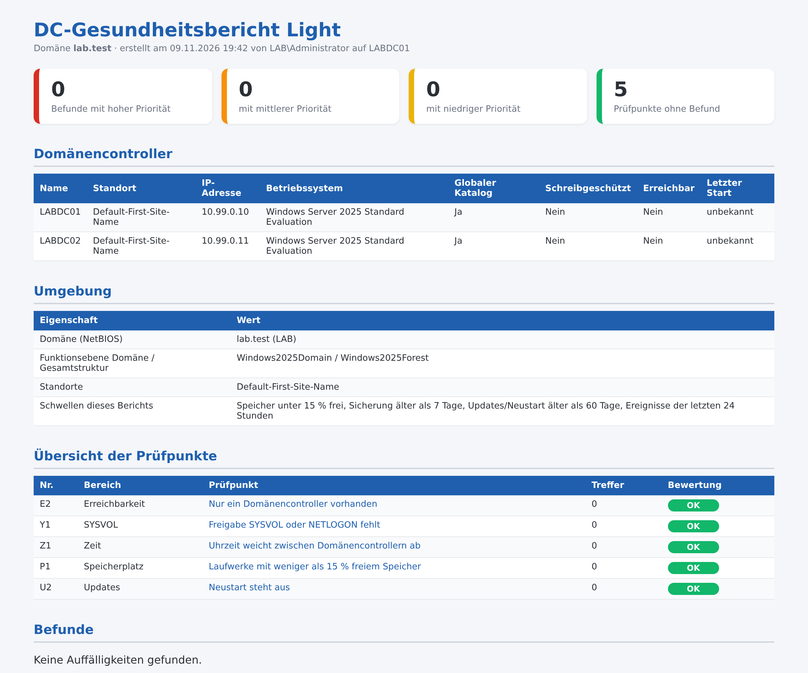

# DC-Gesundheitsbericht Light – Domänencontroller schnell prüfen

Kostenloses PowerShell-Skript: prüft Erreichbarkeit, SYSVOL, Uhrzeit, Speicherplatz und Neustartbedarf der Domänencontroller in **5 Punkten** und erzeugt einen übersichtlichen **HTML-Bericht auf Deutsch**. Es arbeitet **ausschließlich lesend**: Es ändert nichts, legt nichts an und überträgt keine Daten.



Der gezeigte Bericht stammt aus einer Testdomäne. Das vollständige Beispiel liegt als [Beispielbericht.html](Beispielbericht.html) bei.

## Was geprüft wird

| Nr. | Bereich | Prüfpunkt |
|---|---|---|
| E2 | Erreichbarkeit | Nur ein Domänencontroller vorhanden |
| Y1 | SYSVOL | Freigabe SYSVOL oder NETLOGON fehlt |
| Z1 | Zeit | Uhrzeit weicht zwischen Domänencontrollern ab |
| P1 | Speicherplatz | Laufwerke mit weniger als N % freiem Speicher |
| U2 | Updates | Neustart steht aus |

Jeder Befund kommt mit Erklärung und Empfehlung.

## Start

```powershell
powershell -ExecutionPolicy Bypass -File .\DC-Gesundheitsbericht-Light.ps1
```

Alle Optionen zeigt `Get-Help .\DC-Gesundheitsbericht-Light.ps1 -Detailed`. Voraussetzungen und Rechte stehen im Kopf des Skripts. Getestet mit Windows Server 2019, 2022 und 2025 in Testdomänen (deutsches Windows).

## Vollversion

Die Light-Version enthält 5 von 19 Prüfpunkten (26 %). Die **Vollversion** prüft zusätzlich unter anderem:

- Domänencontroller nicht erreichbar
- Inhaber einer Betriebsmasterrolle (FSMO) nicht erreichbar
- Fehler oder Rückstand bei der Replikation des Verzeichnisses
- SYSVOL-Replikation nutzt noch FRS
- SYSVOL-Replikation (DFSR) nicht im Normalzustand
- DNS-Einträge der Domänencontroller fehlen oder sind falsch
- Domänencontroller nutzt fremde DNS-Server
- PDC-Emulator ohne externe Zeitquelle
- Wichtige Dienste laufen nicht
- Seit über N Tagen kein Update oder kein Neustart
- Domänencontroller mit nicht mehr unterstütztem Betriebssystem
- Seit über N Tagen keine Sicherung des Verzeichnisses vermerkt
- Fehler in den Ereignisprotokollen der letzten N Stunden
- dcdiag meldet Fehler oder Warnungen

➜ **[Vollversion auf Gumroad](https://mueller86.gumroad.com/l/bseljr)** · **[Vollversion auf Etsy](https://www.etsy.com/listing/4593087246)** · **[alle Prüfskripte im Shop](https://www.etsy.com/shop/ITAdminToolsbyMM)**

## Weitere kostenlose Prüfskripte

- [AD-Schnellcheck](https://github.com/jackyno7/ad-schnellcheck) (8 Prüfpunkte zur Domäne)
- [Rechner Inventar Light](https://github.com/jackyno7/rechner-inventar-light)
- [Anmelde Sperrbericht Light](https://github.com/jackyno7/anmelde-sperrbericht-light)
- [Berechtigungsbericht Light](https://github.com/jackyno7/berechtigungsbericht-light)
- [Dateiserver Bericht Light](https://github.com/jackyno7/dateiserver-bericht-light)
- [GPO Bericht Light](https://github.com/jackyno7/gpo-bericht-light)
- [Kerberos Altlasten Check Light](https://github.com/jackyno7/kerberos-altlasten-check-light)
- [DNS DHCP Bericht Light](https://github.com/jackyno7/dns-dhcp-bericht-light)

## Hinweise

- Der Bericht enthält Konto-, Rechner- oder Servernamen – bitte vertraulich behandeln.
- Der Bericht zeigt Auffälligkeiten anhand fester Regeln. Er ersetzt keine Sicherheitsprüfung und erhebt keinen Anspruch auf Vollständigkeit.
- Nutzung auf eigene Verantwortung, siehe [LICENSE](LICENSE).
- Bei der Ausarbeitung wurden KI-Werkzeuge unterstützend eingesetzt; Inhalte und Skript wurden fachlich geprüft und im Testlab getestet.

---

### English

Free, read-only PowerShell script that checks reachability, SYSVOL, time, disk space and pending reboots of domain controllers (5 checks, German HTML report with findings and recommendations). No changes are made and no data leaves the machine. Run: `powershell -ExecutionPolicy Bypass -File .\DC-Gesundheitsbericht-Light.ps1`. The full version with 19 checks: https://mueller86.gumroad.com/l/bseljr
